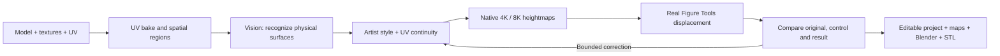

# Sculptor’s Hoard

[Español](README.es.md)

**Turn painted character textures into editable 3D relief.**

A local AI workspace for preparing heightmaps for Blender Figure Tools. Sculptor’s Hoard connects what a surface *means* on a 3D model to how it should displace: an eyelid, a pupil, a buckle and a painted shadow need different treatment.

The project grew from a practical problem: repeatedly recoloring large character textures by hand before preparing figures for printing.



## What it does

- **Reference-image posing (experimental).** Generate an ACNH rig pose from a character card or another image, compare the proposal, and save a separate Blender copy. Codex or explicitly selected local vision interprets the reference; constrained numerical fitting handles the joints. [Usage and limitations](docs/REFERENCE_POSE.md).
- **Semantic preparation.** A vision model observes the complete figure before mapping its parts to numbered UV regions and their projected 3D locations. A validated scene description separates observed geometry from the artist's height policy. Hidden features can request another camera view and a matched close-up; saved per-part evidence is available in the editor. Distinctive details accidentally grouped with a broad surface receive a focused check.
- **Actual 3D feedback.** Blender runs the installed Figure Tools nodes. The reviewer compares the displaced result with a uniform-height control, including facial close-ups. Complete figures are reviewed after body and clothing are assembled.
- **Large textures.** Native-resolution RGBA PNG output with 16-bit heights, bounded-memory row processing, spatial color disambiguation, UV padding and a content cache. Identical black pupils and nostrils can remain independently editable.
- **Useful editing.** Natural-language adjustments, linked heights, group merging and splitting, relief contrast, autosave, named versions, undo and redo.
- **Local production.** Persistent figure queues, phase recovery, model selection/download/load/unload, and observed GPU memory, utilization and temperature.
- **Reproducible evidence.** Each evaluation retains model inputs and responses, masks, plans, native maps, render settings, geometry measurements and saved Blender scenes.

## Run locally

The tested production environment is **Windows, Python 3.12/3.13, Node.js, Blender 5.0 with Figure Tools, and Ollama**. Figure Tools is an external dependency; its code and assets are not included.

```powershell
python -m venv .venv
.venv\Scripts\python -m pip install -r requirements.txt
npm ci
npm run build
.venv\Scripts\python start.py
```

After installation, double-click **Abrir Sculptors Hoard.vbs** in the project folder (Windows, without a console). **Abrir Sculptors Hoard.cmd** and `npm run desktop` also work. The application opens in its own desktop window, with a native Blender file picker. It starts its local processing service automatically; closing the window leaves that service running so queued work can continue. Set `SCULPTORS_HOARD_BLENDER` if Blender is installed elsewhere. If your npm configuration disables install scripts, run `node node_modules/electron/install.js` once to install the desktop runtime.

Use **Nuevo proyecto → Abrir proyecto Blender** to begin. The `.blend` is authoritative: the importer takes its visible meshes, clothing, current pose, material assignments and the exact applied images, including `upscaled_chain` textures. Original images retain their native resolution; only the interactive preview is reduced to 1536 px. The source scene is never overwritten. Import is undoable and a failed import leaves the current project intact.

The desktop picker preserves the original file location, so Blender can resolve relative texture paths. For browser uploads, use packed images or absolute paths. Missing applied images produce an error instead of silently substituting older textures. Materials combining several color images and UDIM textures currently require baking first. **Nuevo proyecto** clears the workspace and keeps the previous project in the saved library, including after reopening the application.

Optional browser mode: `python start.py --web`. The local service uses `http://127.0.0.1:8767`; `python start.py --server-only` runs it without opening a window. Port 8766 belongs to Writer’s Hoard’s AI/MCP bridge. Sculptor’s Hoard does not provide that MCP service.

1. In **Equipo y lotes**, choose an installed vision model and check its real memory state.
2. Scan a folder of `.blend` scenes, select figures and enqueue a preparation. The current complete-figure recipe separates clothing named `mTops`; other material selections are available in the single-figure workflow.
3. Open the saved result and compare the original, uniform control and displaced figure. Review the face, clothing and back.
4. Adjust a group or write an instruction such as *“los ojos más hundidos”* or *“las pecas con más relieve”*. **Comprobar mis cambios** evaluates explicit edits without automatically replacing them.
5. Export native maps, the editable Blender scene or the final STL. Final artifacts must correspond to the current project revision.

Install `blender/relief_bridge.py` as a Blender add-on to send a scene and import exported maps. When manually refreshing Figure Tools textures, the demonstrated workflow remains **Auto Reload → confirm Subdivision → leave the field**. The background worker reloads images and forces reevaluation automatically.

## Hoard family

`faustus-plugin.json` lets Hoard Hub discover and start the app; there is no `/api/agent/call` contract. When an evaluation finishes and has produced `figure-ready.stl`, the app announces it on the family bus as `gepetto.export.done {path, ref, title, format, project_id, job_id}` (`ref` is `hoard://gepetto/export/<job id>`, `title` is the project name followed by "relief"). The Hub's recommended rule hands the `path` to the model library (`model_import_file`). The app writes `data/mcp-token` at start (the Hub knows the sender by it); without the Hub nothing changes. The STL is the only mesh export Sculptor's Hoard produces (no 3MF), and the PNG map bundles are not announced. `backend/hoard_link/` is the shared family library, vendored unchanged; the app takes from it the request guard (loopback Host, Origin and Fetch Metadata rules on every request; `GEPETTO_ALLOWED_HOSTS` opens a LAN or tailnet name on purpose), the token file, atomic writes of `project.json`, the undo history and the pose runs (`atomic`), and the Blender process runner (`proc`, which kills Blender's whole process tree on a timeout and logs everything it printed). `/api/health` reports `service` next to the older `application` key.

## Faustus copilot

A floating **Faustus** button (bottom right) opens a side panel with the Faustus chat, served by Faustus through this app's own relay (`/api/copilot/*`; the Faustus token stays on the server). The conversation, model and tools live in Faustus; the app keeps no chat loop or history. One conversation is kept per project.

Each turn carries what is open, read with the app's own API: the **project** (id, name, texture and model counts, revision, approved, proposal/evaluation present), the open **texture** (id, name, prepared regions, approved), the selected **region** (`<texture id>:<region number>`, name, height, geometry), the **evaluation** when there is one, and the page (workspace, team and batches, or pose from image) with the 3D/UV/relief surface, image mode and inspector tab. Unsaved input goes in `view.editor`: a region name or height being edited (with the saved values beside it) and an instruction typed but not sent. After an agent turn the project list and the open project reload by themselves; fields the user is editing stay intact while untouched fields follow the refreshed project.

Turn it off with `HOARD_COPILOT=0` (the relay, the launcher and the button disappear). Faustus is found through `HOARD_FAUSTUS_URL` (and `HOARD_FAUSTUS_TOKEN`) or the Hoard Link config. Region edits send only changed fields to a partial-update endpoint, preserving an agent's changes to other fields. The original full-list revision guard remains available. Context is captured before asynchronous project reads.

## Height policy

The initial eye order follows the artist's preference:

**sclera < iris < pupil < skin < eyelid < eyebrow/eyelash**

An iris is not invented when the artwork does not distinguish it. These are local displacements on existing geometry, not absolute 3D positions. Explicit edits take precedence. In the native Figure Tools profile, **128 is a reference height, not zero displacement**.

## Evaluation and limits

The repository contains deterministic tests for spatial masks, native output, UV padding, band boundaries, continuity, commands, revision conflicts, history recovery and queue checkpoints. Run:

```powershell
python -m pytest -q
npm run build
```

Real Blender/VLM trials are kept separately from these tests. `scripts/benchmark_first_pass.py` runs fresh complete-figure evaluations without previous semantic decisions. `scripts/score_first_pass.py` compares an output with a separately curated reference at feature level, so correct skin cannot hide a missing eyelash. Private character assets and generated working data are excluded from Git.

A checked 8192² RGBA/16-bit body map exported in **20.28 seconds**; four maps up to 8K took **31.02 seconds** with UV padding, without cache, on the development machine. These timings measure export, not full AI generation. See [evaluation notes](docs/EVALUATION.md) for the hardware, failed trials and practical limits.

Vision models still make semantic mistakes, and their own approval can be wrong. A closed mesh alone does not prove that thin clothing survived or that a figure is ready to print. Outputs remain reviewable proposals. This project does not claim universal five-minute preparation, calibrated confidence or a model trained from scratch.

## Engineering

Electron for the desktop window and native file picker; React, TypeScript and Three.js for the workspace; FastAPI, NumPy, SciPy and scikit-learn for processing; Ollama for local vision/language; Blender as the geometry evaluation engine; SQLite WAL for history and production queues.

- [Architecture and design decisions](docs/ARCHITECTURE.md)
- [Figure Tools integration](docs/FIGURE_TOOLS.md)
- [Evaluation evidence and limitations](docs/EVALUATION.md)
- [Portfolio case study](docs/PORTFOLIO.md)

Code is available under the [MIT license](LICENSE). Third-party models, add-ons and input assets retain their own licenses.

### Compatibility with earlier names

Existing saved projects and browser preferences remain available. The Blender bridge reads both `sculptors-hoard-project.json` and legacy `relief-project.json` exports. `RELIEF_BLENDER` and `RELIEF_DATA_DIR` remain supported as fallbacks for `SCULPTORS_HOARD_BLENDER` and `SCULPTORS_HOARD_DATA_DIR`. The internal `relief.*` Blender operator identifiers are retained for existing integrations.
