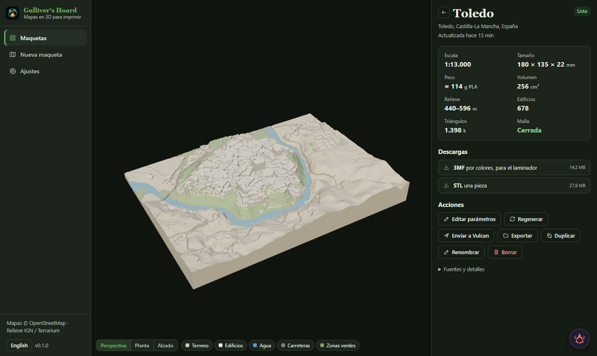

# Gulliver's Hoard

Assembly guides use a kept build's original STL bases, thumbnail, files and saved printer/material snapshot. In the model viewer, expand **Assembly guide**, choose the build and prepare its numbered north-up plan. The self-contained HTML can be downloaded, printed or saved as PDF through the browser. It lists matching STL/3MF names, dimensions, bed fit and material colours; separated framed panels stay independent. Underside engraving is mentioned only when the saved parameters confirm it. Pin diameter/cut length come from that generation; their positions are not drawn. Older exports without parameter snapshots still give the actual base plan and files, with unknown pin/label settings stated. Read pages through `model_assembly` (`next_offset`); create HTML/SVG with `model_assembly_export`. Generated guides also join the ordinary file/export list without rewriting old meshes or reports.

Print profiles save bed size, nozzle and filament density, price and optional colour, with per-part overrides. Settings edits do not change existing models: each model stores a profile snapshot. Pick a profile in New model, or prepare a separate variant from a finished model. Profiles can be archived and restored. Preview bed checks and builds use the same snapshot.

The model page estimates grams and cost per part from geometric volume, surface area, wall thickness and infill. Prices are user-entered; an unknown price leaves the total unknown. This is not a slicer quote: purge, supports, energy and time are excluded, and material is allocated by geometric volume share. Older builds need regenerating for this estimate. Thin-feature buttons place rings on buildings, roads, paths, railways, green areas and tree crowns in the 3D preview; tiny isolated bodies remain report counts. Rings are never included in print files.

The MCP catalogue has 32 tools. `print_profiles`, `print_profile_save` and `print_profile_archive` manage profiles; `model_profile_apply` prepares a variant by default; `model_materials` quotes a kept build or another saved material profile without changing geometry; `model_issues` returns preview coordinates in millimetres (Z up), optionally filtered by part. Results are paged: follow `next_offset` until null to read every location.

Makes printable 3D models of real places, anywhere on Earth. Pick an area on the map; the app downloads the relief and what is on the ground and builds a closed solid with the terrain, every building at its height (in Spain from the cadastre, part by part, with its real number of floors; in Spain and other European countries also from a laser surface model), roofs, towers and spires where they are mapped, every tree it can see (on the aerial photo in Spain, on a global canopy height map everywhere), lakes, ponds, rivers and the sea lowered as water, streets cut along their real outline, railway beds, footpaths through the parks and trails across the mountains, bridges standing on arches over the water, farm fields one by one with their crop rows, squares, and on mountains bare rock and snow; if you want, also contour lines, a frame with a plaque, a route of yours raised as a ribbon, your own house in gold and a text engraved underneath. Where the open map is thin (a village nobody has mapped) the gaps are filled from worldwide satellite data: building footprints, tree heights and land cover. The model can be a rectangle, a rounded rectangle, a circle or a hexagon, and it can be cut into tiles that fit the printer bed, with holes for alignment pins, or into framed panels that hang side by side. It comes out as one STL, as a 3MF with one coloured part per filament (terrain, buildings, water, roads, railways, green, trees, squares, fields, route, your place, plaque, rock, snow, frame), one STL and one 3MF per tile, and a 3D preview in the browser. Part of the Hoard family: it works on its own, from the Hoard Hub, from Faustus and from any MCP client.

Lea esto en español: [README.es.md](README.es.md).

Terrain in `auto` now tries bare-earth LiDAR in Navarra (2 m), Gipuzkoa (2017, 1 m), the Netherlands (AHN DTM, 0.5 m) and France (LiDAR HD MNT, 0.5 m) for areas up to 25 km², sampled at the model's ground-cell size. These are native source resolutions, not a promise of submillimetre print detail or complete coverage. The source check lists candidates; the build report records the source that answered, actual sampling and gaps. Survey gaps borrow measured bare ground: up to 30 m in enclosed gaps, and up to 60 m in open gaps whose coarse reference lies above sea level. Cells at or below the sea threshold and other missing cells retain the IGN/Terrarium fallback. The report distinguishes interpolation from measured ground. The national Spanish WCS still offers 5 m as its finest terrain grid. Explicit IGN or Terrarium selections are preserved.



## What it does

- **Choose the place.** Search by name (OpenStreetMap's Nominatim), then move the area on the map (drag the centre, resize from the corner, click to recentre). Base maps: OpenStreetMap, OpenTopoMap, the IGN PNOA aerial photo for Spain and a world satellite layer. Everything outside the area is dimmed and the tile seams are drawn on it.
- **See what you will get before building.** Scale (1:N), size in millimetres, ground size, tiles and their size, the elevation source that will be used, which streets will be drawn at that scale, warnings (does not fit the bed, buildings too small at this scale, mesh too fine) and a one-click tile suggestion. "Count what is on the map" downloads the map data and says how many buildings, streets, water and green there are, and which landmarks.
- **Three presets.** City (buildings, streets, trees, about 1:3.000 to 1:15.000), Landscape (relief, contour lines, rivers, main roads, trails, woods, rock, snow and green fields) and Relief only (terrain and water in one piece). Every parameter can be changed afterwards.
- **Elevation.** In Spain the 5 m MDT of the Instituto Geográfico Nacional (25 m or 200 m for big areas), with Terrarium filling whatever it does not cover; elsewhere the Terrarium tiles (SRTM, EU-DEM, 3DEP and others, about 30 m in Europe, finer in the USA). The grid is smoothed according to the real resolution of the source so 5 m steps and 30 m facets do not show; the false pits of radar elevation (cones tens of metres deep along shores and in its voids) are filled to their rim, while real valleys and wide basins stay.
- **Buildings.** In Spain (except Navarre and the Basque Country, which keep their own cadastres) they come from the cadastre's INSPIRE service: every building part with its exact footprint and its floors above ground, so a block with a lower wing or a tower on a podium comes out stepped as it is. Elsewhere, OpenStreetMap: `height`, levels, roof levels or an estimate by type. On top of either, what OpenStreetMap maps in 3D: building parts (towers, a spire on its tower, a dome on its drum, drawn floating on what is under them), and roofs — gabled, hipped, half-hipped, mansard, lean-to, pyramids and spires, cones, domes, onions and barrels; with "Roofs: auto" houses and churches without a mapped roof get a pitched one. Small buildings are kept when they belong to a block big enough to print (a row of terraced houses) and dropped only when they stand alone; towers and spires stay however slim.
- **Buildings anywhere.** Where OpenStreetMap has no building and the cadastre is not used, the footprints of Microsoft's Global ML Building Footprints (traced from imagery, worldwide) fill the gap and, in Africa, South and South-East Asia and Latin America, so do the roofs Google Open Buildings 2.5D sees from space, each with its height (a raster of building presence and height turned into houses one by one, squared where they are rectangles), so a village nobody has mapped still gets its houses; when a footprint carries a height it is lent to an OpenStreetMap building that has none (`buildings_source` auto).
- **Real heights from laser.** With `dsm_heights`, buildings drawn only as outlines take their roof height from an open laser surface model, and towers and spires that rise above the roof become parts of their own. Models used without a key: in Spain the national PNOA-LiDAR surface model of the IGN (0.5 m where flown, 2.5 m elsewhere) and, first where they exist, the regional ones of Navarre, Gipuzkoa and Cantabria; AHN4 (Netherlands), IGN LiDAR HD (France), Environment Agency DSM (England), North Rhine-Westphalia, swissSURFACE3D (Switzerland), Flanders, Norway and Poland. Denmark works with the free Dataforsyningen token entered in Settings (stored on this computer and never shown back). A height already known (the cadastre's floors, a mapped height) gives way to the laser's when they roughly agree or the laser is clearly higher (a building grown since), and is kept when the laser is far lower (a surface model older than the building); towers and spires are added either way. With `laser_roofs` (on by default) the roof itself is the laser's too: each roof is fitted to a gabled roof (ridge along the building or across it), a hipped roof or a flat one, with its real slope and eaves; a big roof that is not pitched is drawn in levels (a tower block on its podium, a stepped terrace), each at least 8 m wide with straight walls, after taking out the machinery that stands on it. Where the model is too coarse to tell (the 2.5 m national model on a small house), the usual roof is kept. It applies to areas up to 25 km² at about 1:83.000 or finer.
- **Trees.** Where a laser surface model is used, first the trees the laser sees: crowns at least 3 m tall in the surface model minus its ground, away from buildings, and rough as leaves are (the flat top of a bridge, a wall or a lorry is not a tree), each at its measured height and with its measured width, and a conifer when its crown comes to a point; then, everywhere, at scales finer than about 1:15.000, every tree of the global canopy height map (Meta and the World Resources Institute): each one is a local maximum of the vegetation height and stands at its real height. Conifers are cones and broad-leaved trees rounded: the kind comes from the `leaf_type` mapped in OpenStreetMap or from needle-leaved woods, and for trees nobody classified, from a share set by latitude and altitude. In Spain the PNOA aerial photo (IGN) adds the small street trees the canopy map misses: the photo is read at half a metre a pixel, crowns are the dark, clearly green blobs (lawns are paler, shadows grey), and each crown becomes a 3D tree of its size. The trees and rows of trees mapped in OpenStreetMap are always used; where no survey sees the trees, woods are filled densely and parks scattered. Hedges mapped with the fields become rows of bushes. No tree stands in a river, a lake or the sea. Trees are their own part (and colour) and stand on whatever ground is under them. `tree_source` osm uses only the mapped ones.
- **Water and the rest of the ground.** Lakes, reservoirs, ponds, pools and fountains, river areas and docks, multipolygons assembled properly (a lake keeps its islands, a building its courtyard), rivers and canals drawn as lines; streets by class with their real width (never narrower than the nozzle can print), narrow slivers between nearly touching streets and traffic islands too small to print merged into the street; railways as raised ballast beds in their own colour (trams run in the street); footpaths inside parks and woods cut out of the green so the ground shows through (on open land, every trail, across the rock and the snow too); bridges over water as a deck on piers and round arches (rail bridges too), touching decks sharing one height; bridges over streets, railways and ravines as a thinner deck over the dip the elevation model shows under them, so the road under stays open; weirs and dams as a low wall across the water; piers, jetties, breakwaters and groynes as a deck standing in the water (the sea too); with `water_lines`, thin grooves in the water follow the shore of lakes and the sea a little way out, like depth lines on a chart (the presets draw two or three); tunnel mouths (`tunnels`) as an opening at the foot of the slope where a road or railway goes into a hill, with the hill as its roof (underpasses under flat ground stay out).
- **Mountains.** Snow above an automatic snow line on summits over 2,000 m (or the one you set) wherever the slope holds it (cliffs stay bare rock) and, a little below the line, on the shaded side facing the pole, so a range shows patchy snowfields instead of a white cap; also on mapped glaciers; bare rock where the PNOA aerial photo shows bare stone in Spain (meadows and woods where it shows them, rock by slope where it is unclear; elsewhere, or with the option off, on slopes steeper than the set angle) and where OpenStreetMap maps rock or scree, trees in the woods the photo shows, and, with "All open land green", green everywhere else. The vertical exaggeration is lowered when the relief would be taller than a set share of the model's width (a range drawn at a city's exaggeration is a forest of needles).
- **Land cover anywhere.** With `landcover`, ESA WorldCover (10 m) fills what the map does not draw: woods (inside a town only big ones), grass and scrub outside towns, crops as fields, bare rock on mountains, snow, and lakes nobody traced (the sea is left out). A village in the Amazon or the Sahel gets its forest and its fields.
- **Farm fields.** With `fields`, farmland (OpenStreetMap's farmland, meadows, orchards, vineyards and the like, and WorldCover's crops where nothing is mapped) is cut into parcels along the edges of the mapped fields, the cadastre's farm parcels (Spain), farm tracks, paths, ditches and streams, and hedges. Every parcel is part of the "Campos" colour layer, a hair apart from its neighbours so the ground shows between them; in one-colour models those gaps are grooves. With `field_rows`, crop rows are engraved along the long side of each parcel (in Spain, with `rows_from_photo`, along the direction the field shows on the PNOA orthophoto: ploughing, tramlines, rows of vines), `row_spacing_mm` apart (closer in vineyards and orchards, none in meadows).
- **Squares.** With `plazas`, squares, pedestrian areas and sports grounds without grass (running tracks, clay courts, dirt infields) are their own, lighter colour layer (colour mode).
- **A printable solid.** Real booleans (manifold3d). Streets, paths and contour lines are cut along their real outlines (the cut is the outline's prism above a copy of the terrain lowered by the depth), and the coastline is traced from the elevation with marching squares, so nothing is stepped along the terrain grid. Water is cut down to one continuous surface (lakes, reservoirs and ponds flat; rivers slope gently along their course, with no steps across them), buildings stand on the lowest point of their footprint, colour layers stay a hair off the walls of the buildings standing on them, bodies of one part that would only touch along an edge are parted, and every file is checked for open edges before it is offered; the 3MF keeps every vertex apart (six decimals, nine digits where needed) so a slicer reads the same closed parts.
- **Tiles.** Columns × rows of tiles cut from the whole model (rows lettered from the north, columns numbered from the west, the letter engraved under each tile), with horizontal holes across every seam for pins: 1.9 mm holes take a piece of 1.75 mm filament. With `tile_cuts` streets, each seam follows the streets near the straight line instead of slicing through buildings, and the pin holes sit square to the seam.
- **Framed panels.** With `panels_x` × `panels_y`, the model is split into pictures that hang side by side: each panel has its own frame (8 mm if none is asked) and, with the plaque, its own plaque numbered "i/n"; the landscape runs on from one panel to the next. Panels and print tiles do not mix (panels win, and they have no pin holes).
- **Your place and your route.** `highlight_lon` and `highlight_lat` mark a place: the building under the point, with its towers, comes out in gold ("Tu sitio"), or a map-pin marker stands there if there is no building. `track` takes the text of a GPX, KML or GeoJSON file (up to 8 MB) and raises the route as a ribbon in its own colour ("Ruta"), `track_width_mm` wide and `track_height_mm` high, kept off the water. The form has a button to frame the model on the route; through MCP, a `track` with no coordinates frames the model on the route.
- **Frame and plaque.** `frame_style` flat, bevel (chamfered outer edge) or step (a lower outer ledge and a higher inner rim). With `plaque`, the south side of the frame carries the title (`plaque_text`, or the model's name), the coordinates and scale, a north arrow and a scale bar, raised and inlaid in its own colour ("Placa"); the frame is widened to 14 mm when it is narrower. When the strip is too small, the scale bar goes first, then the subtitle, and a long title is shortened.
- **Colour.** In colour mode the 3MF has one named, coloured part per filament (Terreno, Edificios, Agua, Carreteras, Vías del tren, Zonas verdes, Árboles, Plazas, Campos, Ruta, Tu sitio, Placa, Roca, Nieve, Marco, Torres — only the ones the model has); the parts fit each other exactly and slicers import them as one object with parts. The STL is always the same model in one closed piece. Five palettes set the colours the parts show in the viewer, the picture and the slicer (`palette`): classic (muted map), sand (warm sand ground, white streets and buildings, bright green, light blue water; the city preset's), grey (dark grey ground under white streets and buildings), white (everything white but the water) and alpine (bright meadows, dark grey rock, white snow; the landscape preset's). With `tall_buildings_m`, buildings at least that tall are a part of their own, «Torres», in a colour of their own.
- **3D preview.** Orbit, top and front views, sunlight with shadows, parts that can be hidden, and tiles that can be pulled apart.
- **Builds in the background.** Each build runs in its own process, so the app, the Faustus panel and the agent tools answer while a city is being built; cancelling a build ends that process. A city centre of 5 km² with the cadastre and the aerial trees takes three to four minutes (the first time also two minutes of downloads, then cached). The map data gathered for an area (OpenStreetMap, cadastre, footprints, land cover, parcels, surface heights) is kept for 7 days, so a rebuild that only changes print settings (size, frame, tiles, text, colours) skips the downloads and the work on them.
- **Builds kept and compared.** Every model keeps its last builds (`keep_builds`, 2 by default), each with the parameters it was made with. The model page lists them with their printability score and size; any one can be downloaded, exported, compared with the current one (pictures side by side, the parameters that changed, size, weight, triangles, buildings, tiles, score and the parts that appeared or went) or made current again with its parameters (`model_builds`, `model_compare`, `model_build_use`; `model_files` and `model_export` take a `build_id`, and `GET /api/models/{id}/files/{name}?build=<id>` serves its files).
- **Library.** Every model keeps its parameters and its last builds; edit, rebuild, duplicate, rename, export the files to a folder, or send them to Vulcan's Hoard (the 3D print library of the family). The tiles ZIP carries a `LEEME.txt` that says how the tiles and pins go together and which sources to credit.
- **Printability.** After every build, `report.json` carries a check of what an FDM printer can lay down with `nozzle_mm`: a score from 0 to 100, a verdict (`ok`, `review` or `risky`) and advice in Spanish that names the parameter to change, and the same advice as parameter changes (`fixes`: parameter, current value, proposed value). "Apply advice" (and `model_advice`) previews them with the same check as `area_check` (size, tiles, fit to the bed, mesh) and, when applied, changes the parameters and rebuilds, keeping the current build to compare with. It counts, per part, the bodies and the tiny ones that would not stick to the bed, the buildings thinner than two nozzle passes, the share of the road, rail, path and green layers thinner than two passes, and the tree crowns that are too small. With `thicken`, streets, railways, paths and thin buildings (wings, sheds, spires) are widened to two nozzle passes and tree crowns to the nozzle's size, so they print.
- **Photo and video for listings.** The 3D view has buttons for a product photo (PNG, 2400 × 1600, studio background) and an 8-second 360° turntable video (WebM, 1280 × 720). Both are downloaded and also stored with the model's current build (`POST /api/models/{id}/media/photo` or `video`, up to 60 MB; `GET /api/models/{id}/media` lists them and `GET /api/models/{id}/media/photo.png` or `turntable.webm` serves them).
- **Report.** Scale, size, solid volume, an estimate of PLA grams, relief range, buildings drawn, triangles, tiles that fit the bed, the elevation source and its resolution, and the attribution text. It also says where the trees came from (`trees_from`: map, laser, canopy, aerial) and how many are conifers, how many footprints were added, which land cover classes were used, how many buildings were measured on a surface model and how many roofs took their shape from it (`laser_roofs`), how many fields, whether squares, a highlight, a route and a plaque were drawn, how the tiles were cut, and the printability check.

## Running

```
python -m venv venv
venv\Scripts\pip install -r requirements.txt
npm install && npx vite build
venv\Scripts\python -m gulliver_hoard        # http://127.0.0.1:5206
```

`GULLIVER_FAKE=1` builds an invented town (hills, a river with road and rail bridges, a lake with an island, blocks of buildings, a church with a spire, a park with paths, a pond and trees) without the network, for trying the interface. `GULLIVER_DATA_DIR` moves the data folder (projects, builds, the download cache).

Without the app: `python -m gulliver_hoard.cli --place "Toledo, España" --radius-km 1.5 --tiles 2x2 --out toledo` writes the same files into a folder.

The MCP bridge is `python mcp_server.py` (32 tools; `faustus-plugin.json` describes it for Faustus and the Hoard Hub). `model_create` with `lon`, `lat`, the ground size and a preset is enough to get a model; `area_check` answers without building anything; it counts the frame the build will really draw (14 mm with a plaque, 8 mm per framed panel when none is asked) and, for framed panels, suggests how many panels fit the bed. Deleting a model and clearing the cache need `confirm=true`.

## Family

- Finished models are announced as `gulliver.model.ready` and, when "File every model in Vulcan" is on, as `gulliver.export.done` with the path of the 3MF: the hub rule `rule-exports-to-vulcan` files them in Vulcan's Hoard with a reference back to the model (`hoard://gulliver/model/<id>`). "Send to Vulcan" does the same on demand (also the tiles).
- The Faustus panel (the floating Faustus button) sees what is open: the models of the library, the model on its page (status, scale, size, tiles, centre, ground size) and, in the new-model and settings forms, the fields typed and not saved yet (`gulliver:context-request`). When the assistant finishes a turn the page reloads what it shows and keeps what you are typing.

## What it cannot do

- The models are as good as the open data. Outside Spain and the countries with an open laser surface model, buildings without `height` or levels in OpenStreetMap get an estimate by type (the footprints traced from imagery come with a height only for some, otherwise 5.5 m for a small building and 8 m for a bigger one); roofs and 3D parts appear only where someone mapped them (or, with "auto", as pitched roofs on houses and churches). It does not use photogrammetry or the photorealistic 3D tiles of commercial map services (their terms forbid making products from them).
- Individual trees appear only finer than about 1:15.000 (further out a single crown is smaller than the smallest printable tree, so woods are filled instead). The canopy height map and the land cover come from satellite imagery processed by a model: the canopy map has about 1.2 m pixels, so a lone street tree or a hedge can be missed or merged, and WorldCover is the state of 2021 at 10 m. The aerial photo (Spain only) reads trees by a colour rule, not a trained model: dark hedges can pass for trees and a tree in a building's shadow can be missed.
- Fields outside Spain have no cadastre: they are cut only along what the map shows (mapped fields, tracks, paths, ditches, hedges), so a satellite-only cropland can come out as one big field. There, crop rows follow the long side of the parcel, not the real direction of the furrows (in Spain they follow the photo where it shows a clear direction).
- The laser surface models cover only the countries listed above (Denmark only with its token; Finland has no open one); they are skipped for areas over 25 km² and for scales coarser than about 1:83.000.
- The cadastre answers slowly the first time (about two minutes for a 5 km² city, then cached) and has no data for Navarre and the Basque Country; there the buildings come from OpenStreetMap, completed with the traced footprints. Those footprint files are limited to 400 MB per area: past that, a dense city is left to OpenStreetMap.
- Outside Spain the relief is about 30 m per sample in most of the world: fine for landscapes, coarse for a small town on a slope.
- The sea is whatever is at or below 0 m and touches the edge of the area; land below sea level that touches the edge (polders) is taken as sea. Turn "Sea" off there.
- A tunnel shows only its mouths: the road inside the hill is not modelled. Arches need room: a deck lower than a few tenths of a millimetre over the water is drawn as a solid causeway.
- Very large areas with buildings depend on the Overpass servers answering: hundreds of km² of a city may time out. The mesh has a limit of 3 million cells; past it the app asks for a coarser resolution.
- 3MF colours are names and display colours: the slicer still asks which filament goes to which part.

## Development

```
python -m pytest                            # backend, against the invented town
node --test client/copilot-context.test.mjs  # the panel context
npx vite build                              # interface into gulliver_hoard/static
```

Data: elevation and aerial photo © Instituto Geográfico Nacional (CC BY 4.0) and Mapzen/AWS Terrain Tiles; buildings in Spain © Dirección General del Catastro; map data © OpenStreetMap contributors (ODbL); building footprints © Microsoft (ODbL); roofs and heights seen from space © Google Open Buildings 2.5D (CC BY 4.0 or ODbL); canopy height © Meta and World Resources Institute (CC BY 4.0); land cover © ESA WorldCover project (CC BY 4.0); building heights from the open surface models of each country (credited in the report when used). See [NOTICE](NOTICE). MIT licence.
